# Sechs Häuser, sechs Welten

Die zersprungene Welt besteht aus sechs Bruchstücken, die im Limbus treiben. Jedes Haus hat seine
Heimat auf einem davon, jedes trägt Wappen und Burg. Die Wirkungen der Häuser gelten im Spiel; die
Geschichte dahinter steht in der [Chronik der Welt](CHRONIK_DER_WELT.md).

## Die sechs Häuser

### Haus Silberbach — die Menschen
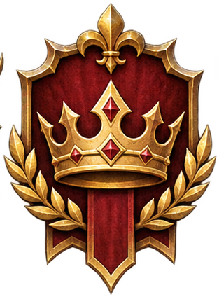

**Heimat:** Midgard · **Farben:** Blau und Silber · **Wirkung:** Holz +5 %, Stein −5 %

Gegründet vom Fischer Karl, der nach dem Bruch dem Klang eines hellen Baches folgte und an einer
Lichtung den ersten Pfahl einschlug. Der Bach heißt seither Silberbach. Die Menschen hier halten
Gemeinschaft hoch, essen Brot, Flussfisch und Apfelmost, bauen in Holz und schießen den Langbogen.
Ihr Fehler ist das schnelle Vertrauen — sie öffnen dem fremden Herrscher gern das Tor.

### Haus Hammerhall — die Zwerge
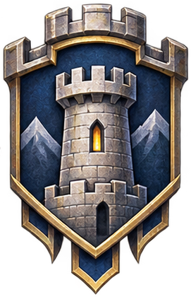

**Heimat:** Armageddon · **Farben:** Schwarz und Gold · **Wirkung:** Stein +5 %, Holz −5 %

Die Zwergenfürstin Brunnhild hörte in den Tiefen von Armageddon ein gleichmäßiges Hämmern und fand eine
Halle, die den Untergang überstanden hatte — in der Mitte ein noch warmer Amboss. „Wo ein Amboss steht,
ist Heimat." Ihre Tore tragen Runen, die an die Verträge der Vorzeit erinnern. Ihr Fehler ist die
Sturheit: Zwerge halten an Entscheidungen fest, auch wenn die Welt sich ändert.

### Haus Sternenwacht — die Elfen
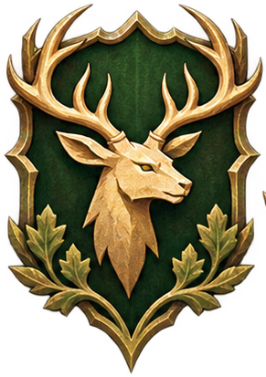

**Heimat:** Valhalla · **Farben:** Silber und Grün · **Wirkung:** Reisegeschwindigkeit +5 %, PA −5 %

Als nach dem Bruch Sternenlicht durch den Nebel von Valhalla brach, deuteten die Elfen es als Zeichen
und errichteten dort ihre ersten Türme. Sie beobachten die Sterne, um den Weg der Welten zu verstehen.
Sie lieben Gesang, Mondfeste, Honigwein und den Bogen; sie reisen schneller als alle anderen. Ihr
Fehler ist die Arroganz — sie halten andere Völker für träge.

### Haus Schattenfaust — die Trolle
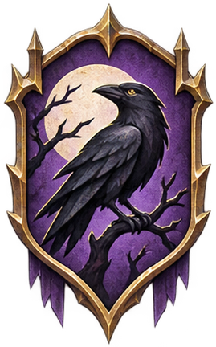

**Heimat:** Utgard · **Farben:** Dunkelrot und Schwarz · **Wirkung:** Angriff +5 %, Handelserloes −5 %

Der erste Troll Gorm ballte nach dem Bruch die Faust und schwor, nie wieder zermalmt zu werden. Der
Abdruck seiner Faust ist heute noch im Fels zu sehen, und um diesen Felsen stehen die Feste. Trolle
essen Braten am Spieß, trinken Met und schlagen zuerst zu. Ihr Fehler ist der Jähzorn.

### Haus Knochenmoor — die Ghule
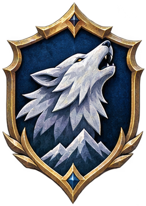

**Heimat:** Ragnarök · **Farben:** Grün und Knochenweiß · **Wirkung:** Nahrungsertrag +5 %, PA −5 %

In den Sümpfen von Ragnarök erwachten Wesen, die nicht mehr lebten und doch nicht tot waren. Die erste
Ghulmutter Mara schichtete die Knochen der Gefallenen zu einer Herdstelle und schwor, das Gedächtnis der
Toten zu bewahren. Ghule finden überall Nahrung, werfen nichts weg, schnitzen Knochen. Ihr Fehler: sie
trauen keinem Fremden, der zu freundlich lächelt.

### Haus Flickwerk — die Gnome
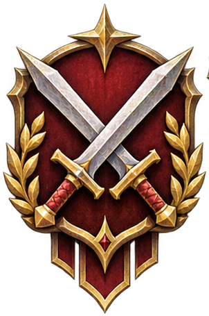

**Heimat:** feste Inseln im Limbus · **Farben:** Messing und Rauch · **Wirkung:** Ausbau +5 %, Angriff −5 %

Als die Welt zerbrach, wirbelte der Limbus Splitter, Fetzen und verlorene Geräte zusammen und formte
daraus Inseln. Aus diesen Inseln erwachten die Gnome — aus der Erinnerung an Werkzeuge, Räder und
Zahnräder. Sie verbinden ihre Eilande mit Seilbrücken und Flaschenzügen, bauen aus wenig viel und
kämpfen ungern. Ihr Fehler: sie verzetteln sich in Nebensächlichkeiten.

## Die sechs Welten

### Armageddon — Fels und Asche
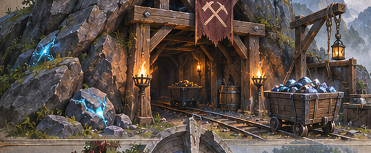

Kahle Felsen, tiefe Schluchten, staubige Ebenen. Beim Bruch wurde diese Welt besonders stark verformt;
Wälder sind selten, der Stein ist von bester Qualität. Hier liegen die Erzadern, aus denen die Zwerge
ihre Rüstungen schmieden. Orte: Hammerhall, der Splittergrat, die Eisklamm.

### Ragnarök — Moor und Untergang
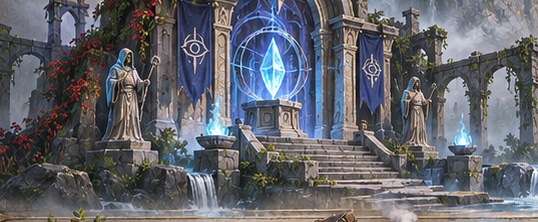

Eine düstere Sumpflandschaft mit Nebelschwaden und verrottendem Leben. Die Magie hat hier den Tod nicht
losgelassen, sondern in den Boden gewebt. Wer hier siedelt, lernt, mit dem zu leben, was übrig bleibt.
Orte: Knochenmoor, die Seufzergründe, das Weihertor.

### Utgard — Hochland der Riesen
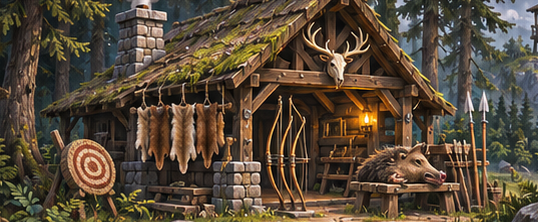

Raues Hochland, wilde Wälder, zerklüftete Berge und große Bestien. Stärke zählt hier mehr als
Diplomatie; wer handeln will, muss kämpfen können oder starke Freunde haben. Orte: Schattenfaust, der
Splittergrat, das Trollmal.

### Midgard — die Herzkammer
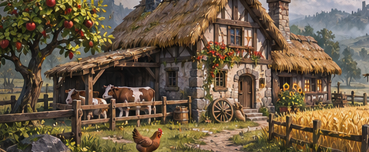

Weite Grasländer, helle Wälder, sanfte Hügel, klare Flüsse — die Welt, die am „normalsten" wirkt. Hier
liegt die größte zusammenhängende Fläche des alten Kernlands. Orte: Silberbach, die Marktfurth, das Alte
Tor nach Valhalla.

### Valhalla — Licht und Wind
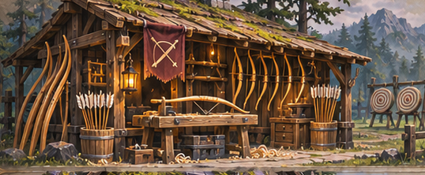

Leuchtende Wälder mit silbrigen Blättern, Kristallformationen und eine Landschaft, die durch die Magie
leicht geworden ist. Die Zeit fließt hier anders, Nächte sind kurz, Tage lang. Orte: Silberlaub, der
Sternenspiegel, die Lichtung der Lieder.

### Die Inseln im Limbus — Flickwerk
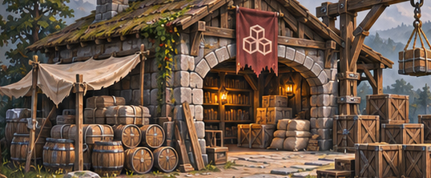

Keine Welt im klassischen Sinn: feste Eilande im magischen Raum, manche so groß wie ein Haus, andere
mit ganzen Werkstätten. Der Raum selbst ist hier biegsam — eine Brücke, heute zehn Schritt lang, kann
morgen dreißig messen. Orte: Flickwerk, das Zahnrad-Archiv, der Marktplatz der Winde.

---

Die Bilder sind eigene Lieferungen und eigene Generierungen. Die Zuordnung von Wappen und Burgen zu den
Häusern ist eine Setzung dieses Projekts — das Originalspiel nannte keine Wappen.
