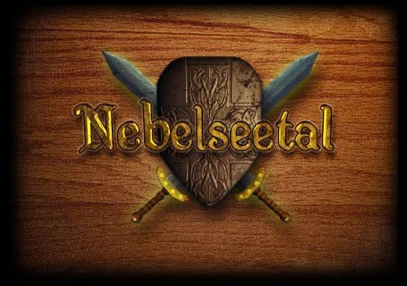

# Nebelseetal Remake

<p align="center">
  
</p>

**Ein eigenständiges, lokal laufendes Einzelspieler-Remake des früheren Browser-Strategiespiels _Nebelseetal_.** Im Mittelpunkt stehen der Aufbau mehrerer Siedlungen, Rohstoffwirtschaft, Handel, Forschung und Auseinandersetzungen mit computergesteuerten Gegnern.

> **Entwicklungsstand: experimentell.** Der Quellcode ist einsehbar und kann getestet werden. Es gibt bislang **keine offiziell freigegebene, vollständig getestete Windows-Version**. Nicht alle Spielsysteme sind fertig oder im Zusammenspiel überprüft.

## Auf einen Blick

| | |
|---|---|
| **Plattform** | Windows (Entwicklungsstart über Python und Tkinter) |
| **Spielmodus** | Einzelspieler, lokal, ohne Spielserver |
| **Technik** | Python, Tkinter, JSON-Spieldaten |
| **Aktueller Stand** | [Spielbereiche, offene Arbeiten und bekannte Grenzen](docs/BESUCHER_STATUS.md) |
| **Entwicklungsverlauf** | [Offizielles Entwicklungsprotokoll](docs/ENTWICKLUNGSPROTOKOLL.md) |
| **Mitmachen** | [Fehler melden oder Vorschläge einreichen](https://github.com/Decay03101991/Nebelseetal-Remake/issues) |

## Was ist im Projekt enthalten?

- Siedlungskarten, Gebäude, Ressourcen und lokale Lager
- Einheiten, Waren, Ausbildung, Forschung und Spielzeit
- Handel, Transporte und Missions-/Kampfsysteme in unterschiedlichen Entwicklungsständen
- Computergesteuerte Gegner, Punkte sowie Sieg-/Niederlagelogik
- Lokales Speichern und Laden; persönliche Passwortabfrage beim Spielstart
- Grafiken, historische Recherche und technische Prüfdateien

**Wichtig:** „Im Projekt enthalten“ bedeutet nicht automatisch, dass jede Funktion vollständig integriert, ausbalanciert oder im fertigen Spielablauf geprüft ist. Die genaue Einordnung steht im [Statusbericht](docs/BESUCHER_STATUS.md).

## Spiel ausprobieren

Derzeit steht **keine freigegebene EXE unter Releases** bereit. Du kannst die experimentelle Python-Fassung unter Windows aus dem Quellcode starten:

1. Auf **Code → Download ZIP** klicken und das ZIP entpacken.
2. Python 3 mit Tkinter installieren (Entwicklungsstand zuletzt mit Python 3.14 dokumentiert).
3. Im entpackten Projektordner `Nebelseetal_Remake.bat` doppelklicken.
4. Beim ersten Start ein **eigenes lokales Passwort** festlegen.

Die ausführliche Anleitung mit Voraussetzungen und bekannten Einschränkungen steht unter **[Spiel testen – Windows](docs/SPIEL_TESTEN.md)**.

Hinweis: Die Passwortabfrage ist eine lokale Zugangshürde, kein Kopierschutz oder zentraler Anmeldedienst. Das Passwort wird nicht ins GitHub-Repository hochgeladen.

## Entwicklungsstand und Dokumentation

Dieses Repository zeigt den veröffentlichten Entwicklungszweig. Die maßgeblichen Unterlagen findest du hier:

| Dokument | Zweck |
|---|---|
| [Besucher-Status](docs/BESUCHER_STATUS.md) | Verständlicher Überblick über alle größeren Spielbereiche und offene Punkte |
| [Entwicklungsprotokoll](docs/ENTWICKLUNGSPROTOKOLL.md) | Chronik der Entwicklungsschritte mit Fehlern, Korrekturen und Testbelegen |
| [Archivierte Protokoll-Vollfassung](docs/ENTWICKLUNGSPROTOKOLL_VOLLFASSUNG_2026-10-05_0820.md) | Historische Detailfassung; nicht automatisch der neueste Stand |
| [Projektstand / Übergabe](docs/PROJEKT_STAND.md) | Detaillierte technische Projektplanung mit teils historischen Abschnitten |
| [Projektordnung](docs/ORDNUNG.md) | Struktur des Arbeitsordners und Regeln für Änderungen |
| [Weg zur Windows-EXE](docs/WEG_ZUR_EXE.md) | Abnahmekriterien für eine spätere veröffentlichbare Version |

**Der Standbericht für Besucher ist eine Zusammenfassung**, nicht die zweite verbindliche Planung. Bei Widersprüchen haben der tatsächlich veröffentlichte Code, die Tests und das offizielle Entwicklungsprotokoll Vorrang.

## Fehler melden und Rückmeldung geben

Teste gern die Abläufe und melde reproduzierbare Fehler über [GitHub Issues](https://github.com/Decay03101991/Nebelseetal-Remake/issues/new/choose). Nützlich sind die verwendete Windows-/Python-Version, die genauen Schritte, das erwartete und tatsächliche Ergebnis sowie gegebenenfalls ein Screenshot.

**Bitte keine Passwörter, API-Schlüssel oder privaten Spielstände veröffentlichen.**

## Projektstruktur

```text
src/       Spielcode
assets/    Spielgrafiken und Icons
data/      Spielwerte und Definitionen
tests/     Automatisierte Prüfungen
tools/     Entwicklungs- und Buildwerkzeuge
docs/      Protokoll, Status, Recherche, Planung und Originalbelege
```

## Veröffentlichung, Rechte und Verantwortung

Dies ist ein **unabhängiges Fan-/Remake-Projekt** und keine offizielle Neuveröffentlichung des ursprünglichen Browsergames. Im Repository liegen auch historische Originalbelege und Grafiken. Für sie gelten gegebenenfalls Rechte Dritter. **Öffentliche Lesbarkeit ist nicht gleichbedeutend mit einer allgemeinen Weiterverwendungslizenz.** Eine solche Lizenz wird hier nicht behauptet.

Die laufende Gesamtkoordination und Freigabe des eigentlichen Spielcodes liegt beim lokalen Projektkoordinator Hermes. Vorbereitungen anderer Entwicklungsagenten werden erst nach Prüfung und Integration Teil dieses Hauptstands.
