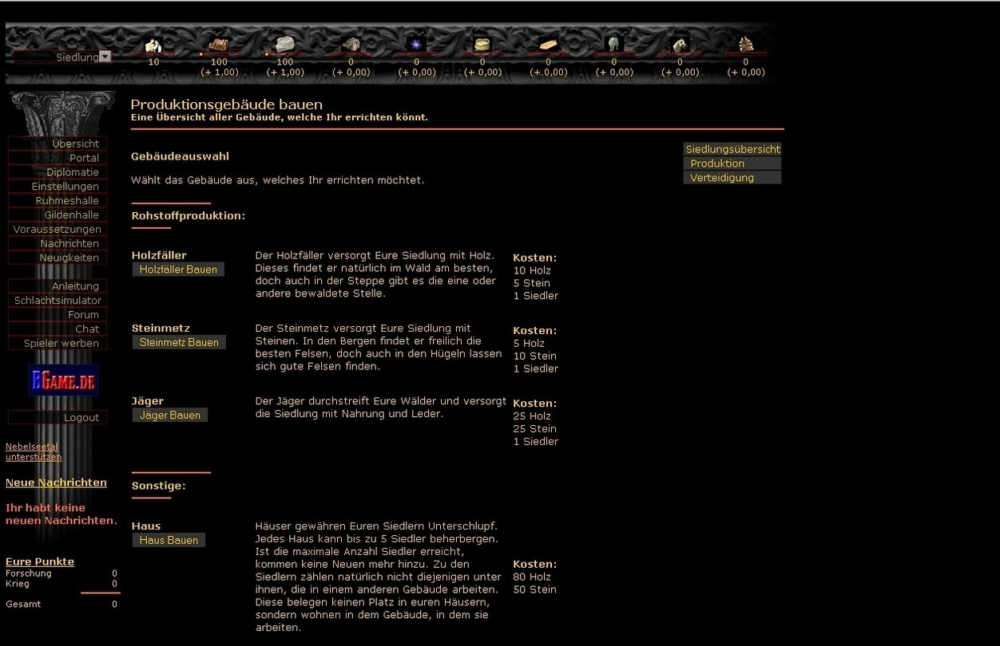

# Nebelseetal Remake – ein konsolidierter Arbeitsstand

**Status: Entwicklung, nicht freigegeben.** Ein Einzelspieler-Remake des historischen Browserstrategiespiels.

> ### Stand 31.10.2026, 13:20 — was heute gebaut und geprüft wurde
>
> * **Vollständiger Prüflauf** (`tools/sammellauf.py`): **98 Dateien, 97 grün, 0 rot, 1 dokumentiert zurückgezogen, 391 s**.
> * **Ausbildungs-Warteschlange** (aus Daniels Spieltest): Restzeit je Auftrag, **Gesamtzeit der Schlange**, Streichen von Aufträgen — `spieloekonomie.ausbildung_uebersicht`, `main._ausbildung_warteschlange_zeichnen`.
> * **Ein Bewegungssystem statt zwei:** Kartenfeld-Beute läuft jetzt über dieselbe Formel wie der Auftrags-Pfad (`kampfbericht.beute_am_ziel`, mit Abbuchung am Feld); der **Rückweg** kostet die gleiche Zeit wie der Hinweg (`main.rueckmarsch_eintrag`, `tests/test_rueckmarsch.py` 16/0/0).
> * **Prüfregister des Originals** auf **63 belegte Punkte** erweitert (`docs/PRUEFREGEL_ORIGINAL.md`).
> * **Code lesbar für Einsteiger:** jeder Abschnitt, jede Funktion kurz erklärt — Regel und Messwerkzeug in [Code-Lesbarkeit](docs/CODE_LESBARKEIT.md) und `tools/kommentar_luecken.py` (213 von 915 Funktionen noch ohne Beschreibung).
> * **Übergabe mit allen Belegen:** [Übergabe 31.10.2026, 14:00](docs/HANDOFF_20261031_1400.md); offene Entscheidungen in [Fragen an Daniel](docs/FRAGEN_AN_DANIEL_20261031_0600.md).
> * **EXE:** `Nebelseetal_Remake.exe`, 43,8 MB, SHA256 `bb97d204…`, Rauchtest bestanden (Tor-Seite erscheint).
> * Besucherstand mit Zahlen: [Spielstatus](docs/BESUCHER_STATUS.md).

> Das Bild zeigt die **historische Vorlage** des Produktions-Baumenues, nicht den aktuellen Programmstand. Was an dieser Darstellung noch fehlt, steht unter [Baumenue-Abgleich](docs/BAUMENUE_ABGLEICH.md).

## Windows-Testversion (FIX04j, noch nicht freigegeben)

**Zwei getrennte Fassungen aus denselben Quellen:**

- **GitHub-Repository:** enthält weiterhin den vollständigen Entwicklungsstand einschließlich aller Admin-Module, Admin-Tests und ihrer Dokumentation. Kein Weglassen von Admin-Daten im Repo.
- **Öffentliches Windows-Testpaket:** wird über `PUBLIC_TEST_EXE_BAUEN_WINDOWS.bat` bzw. `tools/build_public_exe.py` aus `src/public_start.py` erzeugt. Es führt direkt zum normalen Spielermodus mit drei Slots; Admin-Auswahl, Admin-Dialog und Admin-Werkzeuge sind in dieser Bedienoberfläche gesperrt. Die **lokale Entwicklerfassung mit Admin** bleibt unverändert vorhanden.
- **Spielstände:** öffentliche EXE hat ihren eigenen lokalen Speicher-/Passwortordner unter `%LOCALAPPDATA%\Nebelseetal_Remake\Public_Test_FIX04j`; private Inhalte niemals in GitHub laden.
- **Testerinfo:** `release_vorlage/SYSTEMANFORDERUNGEN.txt`, `START_HIER.txt`, `BEKANNTE_GRENZEN.txt` und `FEHLER_MELDEN.txt` gehören zum späteren ZIP mit der EXE.

Die Admin-Sperre der EXE ist **kein sicherer Kopierschutz**: Der vollständige Open-Source-Code bleibt absichtlich öffentlich. `release_public/` ist generiert und darf nicht in Git committet werden; Veröffentlichungen gehen nur nach Windows-Praxistest und Rechte-/Geheimnisprüfung über GitHub Releases. [Releaseplan](docs/RELEASE_PUBLIC_FIX04j.md).

## Einstieg

- `START_SPIEL_WINDOWS.bat` – aktuellen Python-Spielstand aus `src/main.py` starten, kein alter EXE-Build.
- [Aktueller Entwicklungsstand](docs/AKTUELLER_STAND.md) – wichtigste Spielbereiche und offene Punkte.
- [Roadmap / Hermes-Plan](docs/AGENTEN_PLAN.md) – bestehender Agentenplan, unveraendert bewahrt.
- [Einziges aktives Entwicklungsprotokoll](docs/ENTWICKLUNGSPROTOKOLL.md) – **fuehrende Chronik**.
- [Dokumenten- und Quelleninventar](docs/QUELLEN_UND_DOKUMENTE.md) / [Bildinventar](docs/BILDINVENTAR.md) – was geladen wird, was Vorlagen sind und was zu pruefen bleibt.
- [Windows testen](docs/SPIEL_TESTEN.md) / [neue Windows-EXE erstellen](docs/WINDOWS_EXE_HERSTELLUNG.md) / [EXE-Zielmassstab](docs/WEG_ZUR_EXE.md).
- [Auftrag an Hermes](docs/HERMES_UEBERGABE_AKTUELL.md) – nur eine aktuelle Uebergabe.

## Ordner

| Ordner | Bedeutung |
|---|---|
| `src/` | **Einziger aktiver Spielcode** |
| `assets/` | Spielgrafiken, Icons und unveraenderte Quellbilder |
| `data/` | Spielwerte, Originalkarten, Regeldaten |
| `tests/` | Aktuelle Pruefungen und isolierte Testvorlagen |
| `tools/` | Entwicklungs-, Bild- und Buildwerkzeuge |
| `docs/` | Aktuelle Hauptdokumente, Originalquellen und **genau ein** Entwicklungsprotokoll |
| `archiv/` | Alte Projektfassungen, Uebergaben, Screenshots, historische Pruefberichte; kein aktiver Code |

## Wichtig

Die aktive Kopie stammt aus der isolierten GPT-Testfassung inklusive GPT-FIX02b. Sie wurde **nicht** durch Hermes ins bisherige Hauptprojekt integriert, wurde **nicht** als Windows-EXE verifiziert und ist **nicht** automatisch der Stand des oeffentlichen GitHub-Repositories. Vor einem Merge oder Push muss Hermes Baseline, tatsächlichen HEAD, Geheimnisse und Bildrechte pruefen. Das Verzeichnis `archiv/` ist bewusst von Git ausgeschlossen und bleibt lokale Sicherung.

Das Passworttor bleibt so: Spieler erstellen beim ersten Start **ein eigenes lokales Passwort**. Keine Passwortdateien oder Hashes mitverteilen.

### Kartenstand: nur historische Originalkarten

Diese Entwicklungsfassung nutzt im Siedlungsspiel **127 originale 10×10-Karten** mit direkt aufbereiteten historischen Bildhintergründen. Die ehemals generierten 8×7-Siedlungskarten und ihre grob nachgezeichneten Wald-/Gebirgssymbole sind nicht mehr aktiv. [Kartenregeln und Grenzen](docs/KARTEN_NUR_ORIGINALE.md) · [Aktueller Entwicklungsstand](docs/AKTUELLER_STAND.md).

**Wichtig:** Dies ist eine nicht freigegebene Entwicklerfassung, keine aktuelle fertige Windows-EXE; 25 Karten müssen noch manuell auf Übereinstimmung von Bild und Spielraster geprüft werden.

### Spielstaende verwalten (Entwicklungsstand FIX04h)

Im normalen Profil gibt es drei Spielerslots. Unter **Spielstaende verwalten** werden ausschliesslich die aktiven Slots angezeigt. Loeschen archiviert den ausgewaehlten Stand mit Datum und Uhrzeit **privat im Entwicklungsarchiv**, zeigt ihn aber normalen Spielern nicht wieder als Ladeangebot an. Wiederherstellen ist vorerst nur im getrennt authentifizierten **Admin-Testmodus** moeglich: Dort liegt das Entwicklerarchiv in einem eigenen Fenster mit klarer Slotzuordnung. Ein leeres Archiv erzeugt keinen Wiederherstellungs-Eintrag.

Bewusstes Ueberschreiben eines Slots ersetzt den aktiven Stand unmittelbar. Im Admin-Entwicklerarchiv werden Dateianzahl und Speicherbedarf angezeigt; es erfolgt **keine automatische Loeschung**. Ob das Archiv nach Ende der Entwicklungsphase weiter gefuehrt, begrenzt oder deaktiviert wird, ist noch offen.

Private Spielstaende und ihre Archive liegen im jeweiligen Schreibordner des Spiels, in der Windows-EXE normalerweise im Nutzerprofil, nicht im GitHub-Projekt. `archiv/spielstaende` im Projekt ist nur ein Ordnerplan. Die unter Windows zuvor erfolgreich getestete EXE enthaelt FIX04h noch nicht; nach dem Einspielen ist ein Neubau mit anschliessendem Windows-Test erforderlich.
