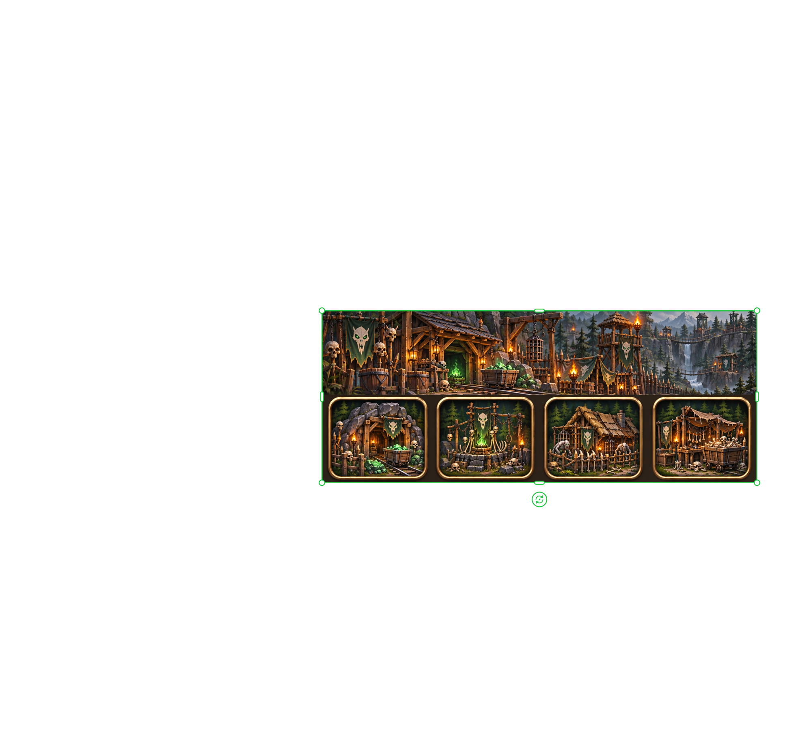
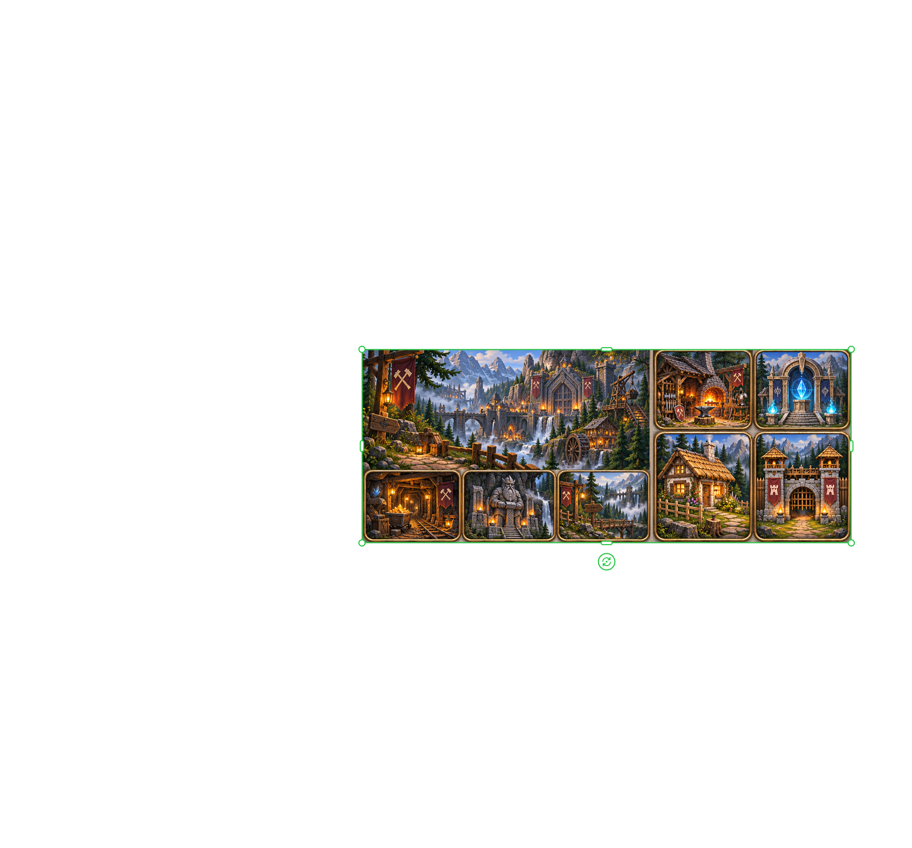
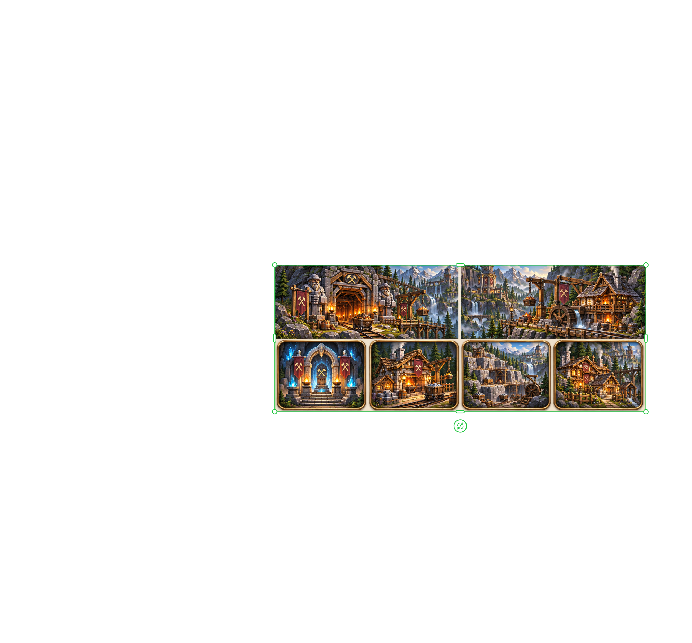
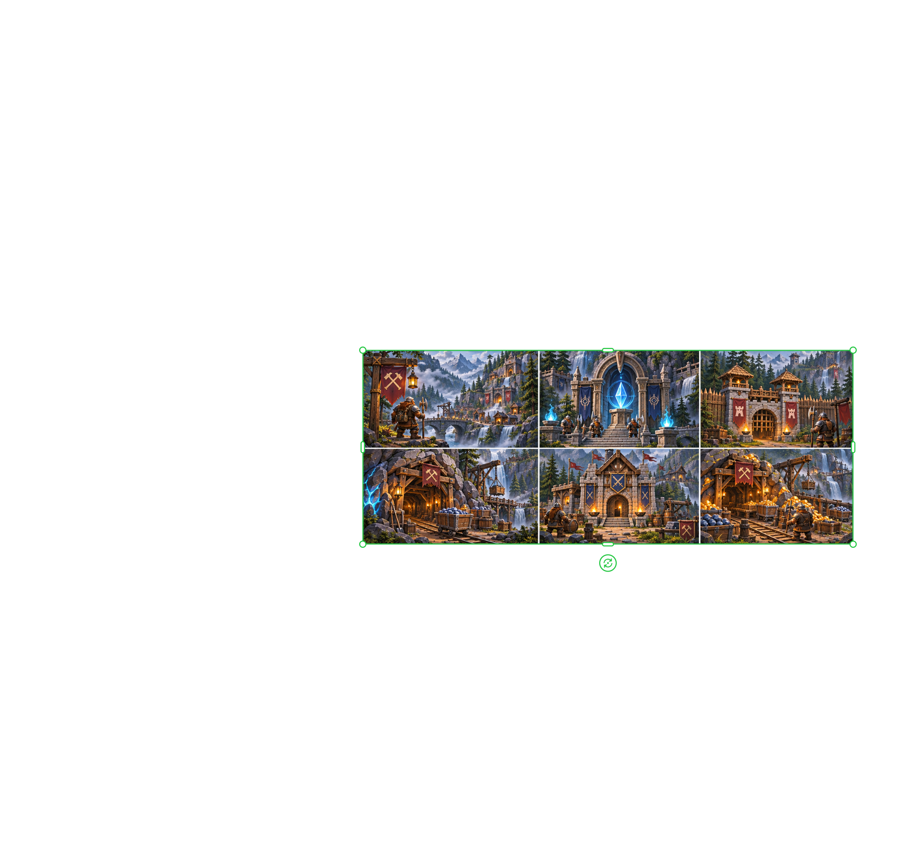
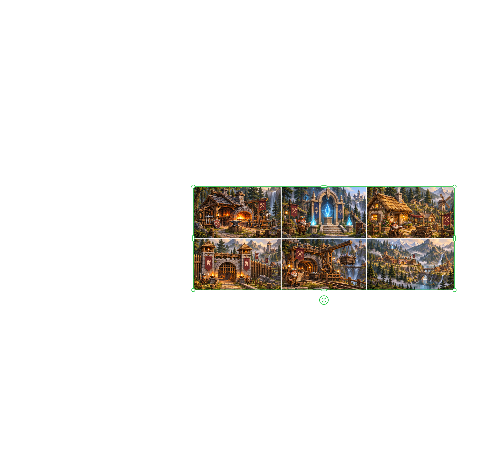
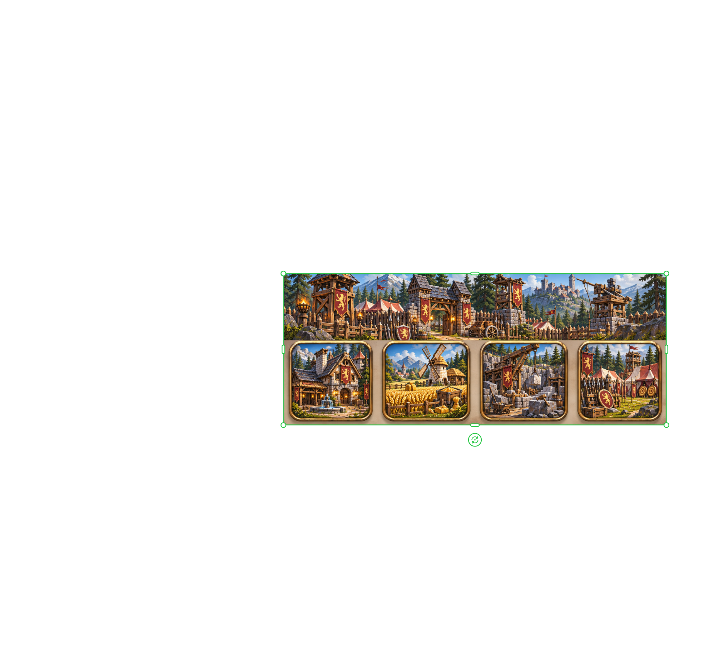
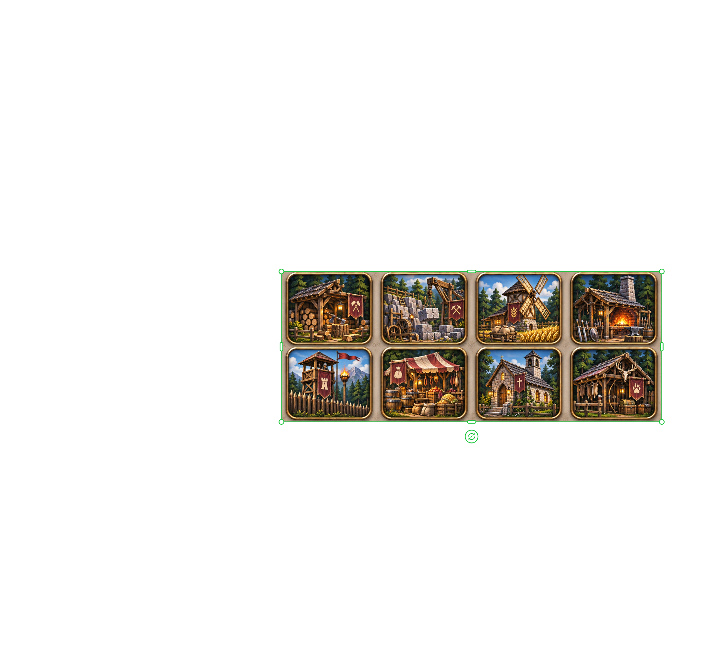
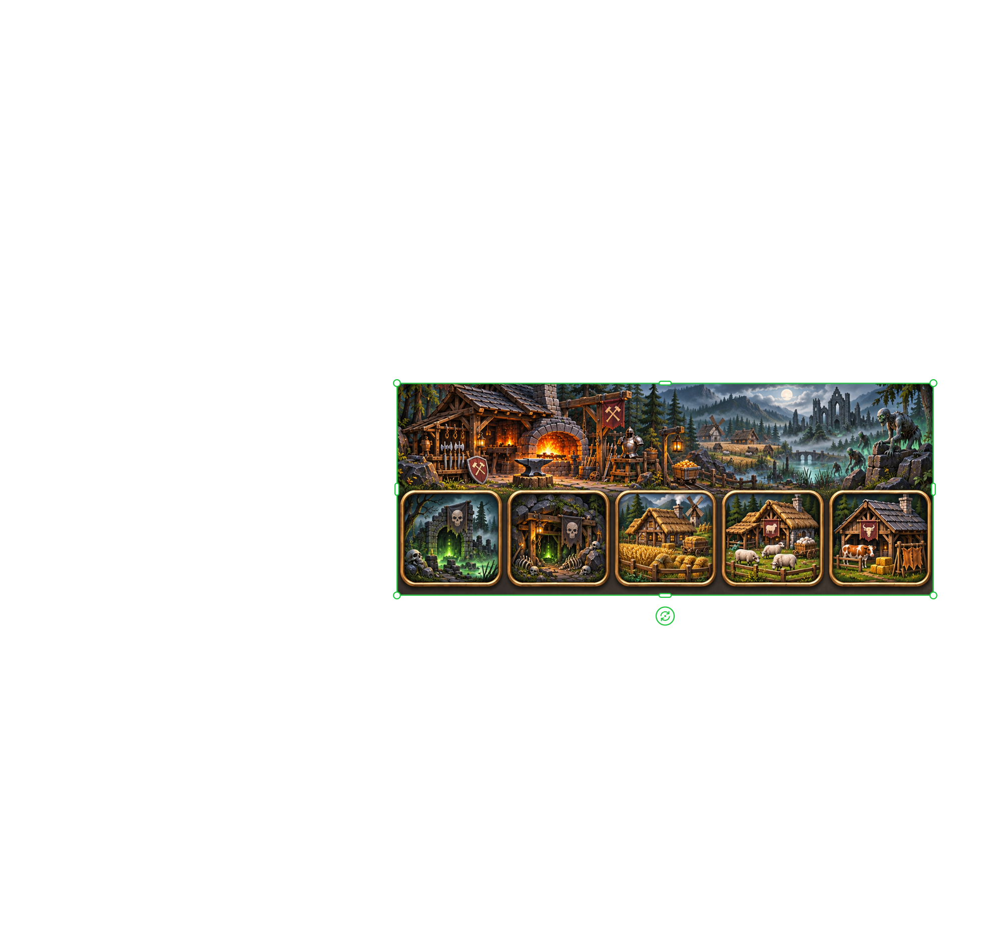
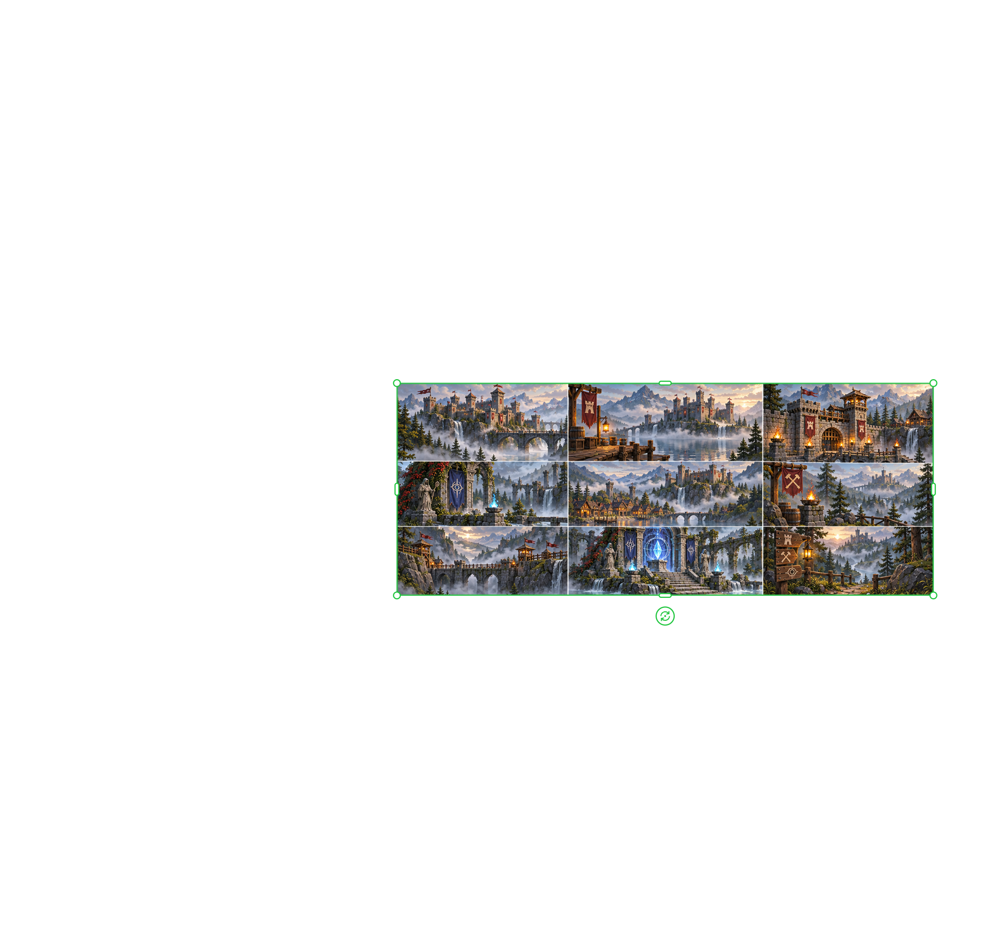

# Erste Eindrücke einer späteren Version

Diese Bilder sind für eine **spätere Fassung** des Spiels entstanden — als Stilrichtung, als Material
für die Weltkarte, die Fraktionen und die Gestaltung der Chronik. **Im aktuellen Pre-Release sind sie
noch nicht eingebaut.** Sie stehen hier, damit man sieht, wohin die Reise geht.

Die Blätter sind so veröffentlicht, wie sie erzeugt wurden: auf jedem liegen mehrere Einzelmotive
nebeneinander, jeweils mit eigenem Rahmen. Eigene Generierungen des Projekts, keine Fremdgrafiken.

## Die Fraktionen

### Ghule — Mine und Verwesung

Ein Panorama und vier Kacheln: Stollen mit Grubenlampen, Erzwagen, Knochenzäune. Die Ghule holen sich
aus dem Boden, was andere liegen lassen.

### Zwerge — Stein, Amboss, Tiefe

 

Drei Blätter für das steinreichste Haus: Hallen, Schmieden, Fördertechnik, Tore mit Runen.

### Gnome — Werkstatt und Flickwerk

Ihre Inseln im Limbus: Werkstätten, Zahnräder, Brücken zwischen Eilanden — gebaut aus dem, was übrig war.

### Menschen — Furt, Feld und Burg

Holzbau, Flussläufe, Wege zur Burg: die Welt, die am „normalsten“ wirkt.

## Gebäude und Gelände

### Gebäude, zwei Reihen

Holzfäller, Steinbruch, Mühle, Schmiede, Wachturm, Markt, Kapelle, Jägerhütte — die Bausteinreihe, aus
der die Siedlungsansicht später bestehen soll.

### Burgen

Zwölf Burg- und Landschaftsbilder als Vorrat für Herrschaftssitze und Kartenhintergründe.

## Panoramen

Weite Täler, Wasserfälle, Hafenstädte, Minen, Weinberge — das Bild, das man im Kopf hat, wenn man an
Nebelseetal denkt.

---

**Zum Stand der Einbindung:** Derzeit sind diese Bilder reines Anschauungsmaterial. Der nächste Schritt
wäre, sie im Spiel zu verwenden — als Kapitelbilder der Chronik, als Fraktionsporträts in der
Völkerwahl und als Hintergründe der Kartenansicht.
